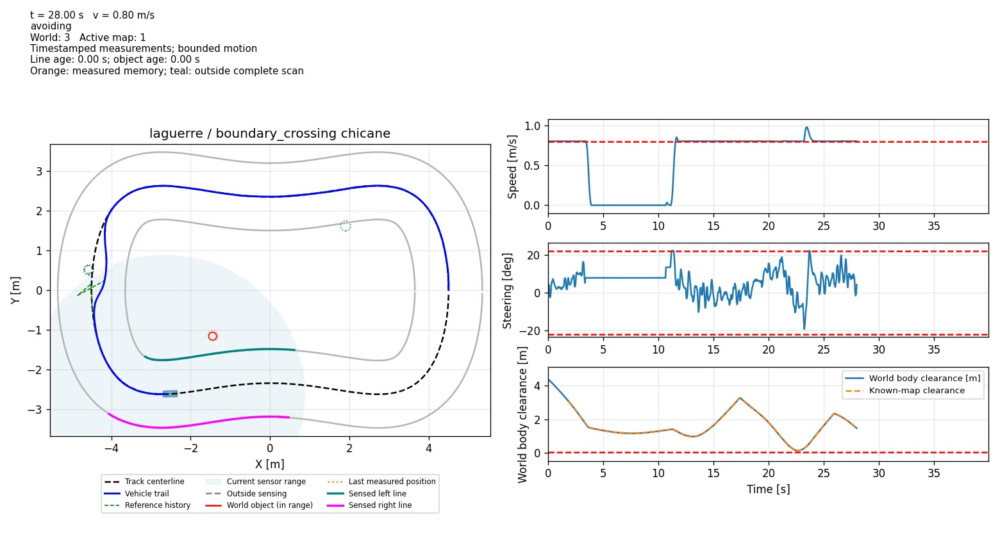

# Laguerre MPC for an Autonomous RC-Car Simulation

**MATLAB simulation of path following, static/moving obstacle avoidance, and
local track-marking following using Laguerre-parameterized, successively
linearized MPC, with full-input LTV MPC and a nonlinear tracking baseline.**

> **Progress snapshot: 28 October 2026.** Controller development is paused.
> This is a simulation and comparison project, not a trained driving policy,
> a camera-perception stack, a ROS2 package, or a hardware-safety certification.

## Start here

- **[IEEE-style technical report (PDF)](docs/paper/main.pdf)** |
  [LaTeX source](docs/paper/main.tex)
- **[Readable progress report](docs/PROGRESS_REPORT.md)**
- **[32-run comparison dashboard](results/published/robustness/dashboard.html)**:
  download/open locally; GitHub displays HTML source rather than hosting the page.
- [Complete comparison CSV](results/published/robustness/summary.csv) |
  [paired CSV](results/published/robustness/comparison.csv) |
  [earlier 23-case study](results/published/legacy/summary.csv)
- [Paused next-work plan and implementation checklist](CHECKLIST.md)

## Watch the demonstrations

The links below open the committed MP4 files directly. No simulator or MATLAB
installation is needed to watch. If a browser downloads the file, open it in a
video player.

[](https://raw.githubusercontent.com/arch1703/Laguerre_MPC_Car/main/results/videos/noisy_sensing_chicane.mp4)

| Demonstration | Direct video | What it establishes |
|---|---|---|
| **Latest: noisy sensing, marked chicane, crossing obstacles** | **[Watch 40 s MP4](https://raw.githubusercontent.com/arch1703/Laguerre_MPC_Car/main/results/videos/noisy_sensing_chicane.mp4)** | Laguerre: 1.025 laps, 3.92 cm path RMS, 15.11 cm minimum conservative clearance, no contact/fallback. Bounded noise; not the latency/missed-detection case. |
| Marked kidney track and transverse crossings | [Watch 40 s MP4](https://raw.githubusercontent.com/arch1703/Laguerre_MPC_Car/main/results/videos/results_ltv_laguerre_boundary_kidney.mp4) | Earlier verified Laguerre recording: stopping, waiting, resuming, and following local boundary lines on a different track. |
| Marked chicane and transverse crossings | [Watch 40 s MP4](https://raw.githubusercontent.com/arch1703/Laguerre_MPC_Car/main/results/videos/results_ltv_laguerre_boundary_chicane.mp4) | Earlier verified cross-track recording; no contacts, solver failures, or fallback. |
| Moving objects on the original oval | [Watch 25 s MP4](https://raw.githubusercontent.com/arch1703/Laguerre_MPC_Car/main/results/videos/results_ltv_laguerre_moving_world.mp4) | Current-position tracking without a directional motion forecast; 2.30 laps, 21.48 cm minimum conservative clearance. |
| Independent random static appearances | [Watch 45 s MP4](https://raw.githubusercontent.com/arch1703/Laguerre_MPC_Car/main/results/videos/results_ltv_laguerre_random_world.mp4) | First unselected seed 312882142: four births, three detections, no contacts/fallback; world does not adapt placement to the car. |
| Independent appearances **and disappearances** | [Watch MP4](https://raw.githubusercontent.com/arch1703/Laguerre_MPC_Car/main/results/videos/results_ltv_laguerre_transient_world.mp4) | **Failure demonstration:** requested 60 s ends at 31.85 s on `unsafe_spawn`, with a terminal-frame hold. No confirmed contact; not a successful mission or physical emergency stop. |
| Short-horizon static avoidance | [Watch 15 s MP4](https://raw.githubusercontent.com/arch1703/Laguerre_MPC_Car/main/results/videos/results_ltv_laguerre_safe_static.mp4) | Earlier tuned Laguerre example: about 1.37 laps and 21.06 cm conservative clearance. |

Earlier videos use their recorded implementation, not necessarily today's
sensing or timing logic. Their historical results must not be substituted for
the current robustness comparison.

## Current comparison: matched 32-run robustness matrix

Sixteen scenarios were each run with Laguerre and full-input LTV MPC, using
identical tuning, horizons, initial conditions, world configuration and indexed
noise draws within a pair. Perceived observations can differ because trajectories
differ. Controller order alternated; warm-up was measured separately.

| Measurement | Laguerre | Full-input LTV |
|---|---:|---:|
| Mission criteria passed | **9/16** | **9/16** |
| Executed-portion safety criteria passed | 16/16 | 16/16 |
| Contacts / road departures | 0 / 0 | 0 / 0 |
| Decision variables | 8 | 12 |
| Mean of per-run **called-optimizer** medians | 9.03 ms | 4.63 ms |
| Online deadline misses | 53 / 11,887 ticks | 1 / 11,886 ticks |
| Full simulator-loop deadline misses | 213 / 11,887 ticks | 3 / 11,886 ticks |

**Fewer variables did not make Laguerre faster in these small problems.**
It remains the educational focus; LTV is the practical computational baseline.
The optimizer statistic excludes waiting ticks and is not a pooled median.
Online time includes sensing, planning, solve and validation; full-loop time
also includes the independent physical monitor and simulator bookkeeping.


Both controllers passed nominal chicane/kidney/oval, bounded-noise, brief
marking-loss, tested plant-mismatch, reversed-crossing, different-start and
watchdog-enabled cases. The watchdog pair had **zero interventions**, so it
does not validate actual overrun recovery.

**Failures remain visible:** latency and larger objects caused checked fallback;
long marking loss, unknown classes and faster crossings stalled; missed
detections and combined uncertainty eventually had no verified control.
Faster crossings also caused repeated solver rejections. An early stopped run
meeting measured safety margins is not proof of future safety or mission success.
The study uses one seed, 41, per configuration; it is not a statistical success
estimate or universal avoidance guarantee.

### Earlier comparison: separate 23-case controlled study

All 23 cases met that study's simulation safety/completion criteria. These used
different tracks/settings and must not be pooled with the robustness matrix.

| Selected case | Path RMS [cm] | Median solve [ms] | Full-loop p99 [ms] |
|---|---:|---:|---:|
| Laguerre tracking | 0.130 | 12.78 | 43.84 |
| Full-input LTV tracking | 0.142 | 8.29 | 24.58 |
| Nonlinear MPC tracking | 0.142 | 836.54 | 925.97 |
| Laguerre static avoidance | 0.228 | 28.53 | 56.27 |
| Full-input LTV static avoidance | 0.249 | 13.77 | 29.24 |
| Short-horizon Laguerre static | 0.227 | 10.76 | 24.08 |

Nonlinear MPC was verified for obstacle-free tracking, **not** as the successful
moving-obstacle controller. It missed all 300 deadlines in that tracking case.
The full table, basis/horizon/speed sweeps, and archived implementation are in
[legacy evidence](results/published/legacy).

## How it works

- Rear-axle state `[X,Y,psi,v]`; steering/acceleration inputs; Euler bicycle model.
- 0.25 m wheelbase, 0.29 m front / 0.06 m rear / 0.075 m half-width body,
  5 cm required conservative clearance, 50 ms sample period.
- Boundary mode: 0.8 m/s target, prediction/control horizons 12/6, four Laguerre
  modes per input, decay 0.7. Full-input LTV optimizes twelve inputs; Laguerre
  optimizes eight coefficients of the **input increments**.
- Local paired boundary-line sensing on oval, kidney and chicane tracks;
  pose and line association are assumed known, not obtained from a camera.
- Independently generated world motion; control receives timestamped detections
  and admissible direction-free speed bounds, not future trajectories.
- Footprint-aware planning, guarded successive linearization, nonlinear rollout
  validation, inter-sample checks and checked stopping reserve before application.
- Bounded noise, acquisition latency, marking loss, missed detections,
  classification uncertainty and limited wheelbase/acceleration mismatch.

There is **no training step**. Repeated simulations verify software and behavior;
MPC itself solves online on each applicable control tick.

## Run and reproduce

### MATLAB

Developed with **MATLAB R2024a**, Optimization Toolbox, and (for the nonlinear
baseline only) Model Predictive Control Toolbox.

```matlab
addpath(fullfile(pwd,'matlab'));

demo = run_boundary_demo('chicane', Duration=40);
baseline = run_boundary_demo('kidney', Duration=40, Controller='ltv');
noisy = run_boundary_demo('chicane', Duration=40, Experiment=struct( ...
    'seed',41,'line_noise',0.02,'obstacle_noise',0.02));

% Older oval scenarios:
static = run_mpc_demo('laguerre','static', ...
    Parameters=struct('Np',10,'Nc',5), Plot=true);
random = run_mpc_demo('laguerre','random', Duration=45);

% Saves a NEW matrix and prints its output directory:
quick = benchmark_boundary('quick');  % 4 pairs, 12 s each
full_matrix = benchmark_boundary('full');  % 16 pairs, 40 s requested each

tests = runtests(fullfile('matlab','tests'));
assertSuccess(tests);
```

Full nonlinear simulations and full benchmarks can take minutes. They are not
needed to view videos or inspect the committed evidence.

### Python visualization and reporting

Python 3.13 was used for validation. Install the existing dependencies:

```powershell
python -m pip install -r python\requirements.txt
python -m unittest discover -s python -p "test_*.py" -v
python python\robustness_report.py results\published\robustness
python python\animate_run.py results\published\robustness\runs\noisy_lines_laguerre
```

For an MP4 export, append `--save --no-show --stride 2`. Install ffmpeg separately
for MP4; the exporter otherwise supports GIF. Existing outputs require
`--overwrite`. Published CSV exports support animation, but omit MATLAB
`run.mat` binaries: `replay_mpc_run` requires an original complete bundle or a
new run saved by MATLAB.

### Paper and figures

```powershell
python python\paper_figures.py
Set-Location docs\paper
pdflatex -interaction=nonstopmode -halt-on-error main.tex
pdflatex -interaction=nonstopmode -halt-on-error main.tex
```

Requires a LaTeX installation with `IEEEtran`. The PDF is an original,
IEEE-conference-style **project technical report**, not a submitted,
peer-reviewed, or IEEE-endorsed publication.

## Evidence, limitations, and status

- [Published data guide](results/published/README.md) explains included files,
  omissions and reproduction. All 32 cases, including failures, are retained.
- [Provenance and SHA-256 checksums](results/published/provenance.json) preserve
  dataset identity; current MATLAB source hashes are in individual manifests.
- Verified controller snapshot: **51 MATLAB tests**, zero Code Analyzer messages.
  Publication tooling adds portable-path/export tests: **13 Python tests** pass.
- Noise is bounded; sensing has no real occlusion/camera pipeline; Bernoulli
  misses make negative evidence probabilistic. Recent stillness does not prove
  an object will remain static. Arbitrary unsafe spawns remain unavoidable.
- Finite stopping checks are not a recursive-feasibility or robust-stability proof.
  Desktop timing is not hard-real-time certification.
- **Recovery development is paused.** The next priorities are diagnostics,
  planner/MPC compatibility, uncertain memory, explicit recovery/abort behavior,
  actual deadline-overrun tests and held-out validation; see [CHECKLIST.md](CHECKLIST.md).
- No ROS2, external simulator or hardware integration is included. No
  open-source license has been selected for this snapshot.
