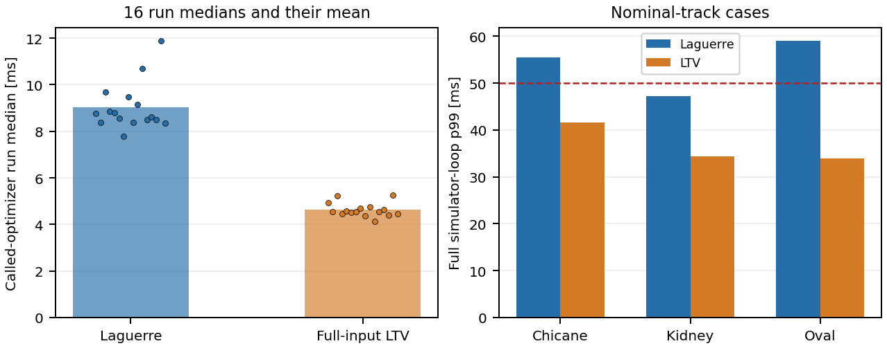

# Progress report: Laguerre MPC autonomous RC-car simulation

**Snapshot:** 28 October 2026

**Project:** [arch1703/Laguerre_MPC_Car](https://github.com/arch1703/Laguerre_MPC_Car)

**Status:** simulation development paused for documentation and publication.

For the mathematical treatment and formatted results, read the
[IEEE-style technical report](paper/main.pdf), with [LaTeX source](paper/main.tex).
This document is the simpler companion write-up.

## 1. Purpose and actual scope

The project demonstrates online model predictive control for an RC-scale
kinematic bicycle. Its preferred educational controller uses Laguerre functions
to parameterize input increments. Ordinary full-input linearized MPC provides
a matched comparison; full nonlinear MPC is an obstacle-free tracking baseline.

There is no learned policy and no repeated controller training. Runtime solves
adapt control to the current measured state and constraints. The many recorded
simulations are development experiments, regression tests and benchmarks.
The work is not a camera stack, ROS2 integration, external driving-world
integration or a hardware-ready autonomous car.

## 2. What has been achieved

1. Repaired continuous/discrete nonlinear-model configuration, reference
   construction, footprint constraints and misleading historical error metrics.
2. Unified dynamics, parameters, references, MPC, validation, logging and animation.
3. Demonstrated static and controlled appearing-obstacle avoidance.
4. Added independent random appearances/disappearances: world events do not
   depend on whether the car can avoid them. Retained an unavoidable-spawn failure.
5. Demonstrated sensor-driven moving-obstacle handling, then transverse crossing
   obstacles and local track-marking following on different tracks.
6. Added linearization trust limits/error rejection, checked braking and
   completed-stop-before-resume logic.
7. Added uncertainty, latency, losses, limited model mismatch, progress-aware
   outcomes, stage profiling and a paired robustness benchmark.
8. Published original measured data, comparison code, relevant videos and this
   report without duplicated source snapshots or binary runtime caches.

The successful avoidance videos use successively linearized MPC, not the
full nonlinear optimizer.

## 3. Architecture and assumptions

The state is rear-axle position, heading and speed. Inputs are steering and
acceleration. Boundary demonstrations run a nominal 50 ms simulation clock
with a 0.8 m/s target, prediction/control horizons 12/6, and the same costs
and limits for both controllers. Four Laguerre modes per input give eight
coefficients, versus twelve full-input variables.

A separate world produces obstacle truth. The sensor delivers only
timestamped local measurements; control does not receive future object
positions or directions. The newer crossing cases use direction-free
speed-bounded expanding regions. World truth is used independently to monitor
actual simulated clearance, not to choose commands.

Track perception means simulated local paired marking measurements with known
pose/association, not image processing. The car follows local marking geometry
on oval, kidney and chicane roads. Body-circle and rectangle measures are
distinguished; the required conservative clearance is 5 cm.

The safety chain is planning, constrained linearized MPC, nonlinear validation,
visibility/stopping checks and checked braking. If no verified action exists,
the simulator stops without applying an unchecked command. That halt is not
a demonstration of physical emergency braking.

## 4. Evidence set A: earlier controlled comparison

The [23-case table](../results/published/legacy/summary.csv) contains shared-runner
tracking, static, appearing/replayed and parameter-sweep cases. All met that
study's completion/clearance criteria, with no sampled collisions or fallback.
This did not mean all cases met accuracy or 50 ms timing targets.

| Selected case | Path RMS [cm] | Solve median [ms] | Full-step p99 [ms] | Missed 50 ms steps |
|---|---:|---:|---:|---:|
| Laguerre tracking | 0.130 | 12.78 | 43.84 | 2/300 |
| LTV tracking | 0.142 | 8.29 | 24.58 | 2/300 |
| Nonlinear tracking | 0.142 | 836.54 | 925.97 | 300/300 |
| Laguerre static | 0.228 | 28.53 | 56.27 | 7/300 |
| LTV static | 0.249 | 13.77 | 29.24 | 0/300 |
| Short-horizon Laguerre static | 0.227 | 10.76 | 24.08 | 0/300 |

At prediction/control horizons 20/10, the two QP variants use eight versus
twenty variables. A short 10/5 Laguerre case uses eight versus ten; it is not
the same problem as the current 12/6 boundary experiment. Later optimized
static-video timing is also distinct from the original sweep row.

## 5. Evidence set B: current 32-run robustness comparison

The [dashboard](../results/published/robustness/dashboard.html),
[all-run table](../results/published/robustness/summary.csv) and
[paired table](../results/published/robustness/comparison.csv) retain every outcome.

Pairs share tuning, seed, initial state and indexed exogenous disturbances.
Sensing depends on trajectory, so equal noise streams do not imply identical
perceptions. Order alternates; warm-up is logged separately. All configurations
use seed 41. This is finite deterministic coverage, not a statistical success rate.

| Measurement | Laguerre | LTV |
|---|---:|---:|
| Completed mission criteria | 9/16 | 9/16 |
| Executed-portion safety criteria | 16/16 | 16/16 |
| Contact / departure steps | 0 / 0 | 0 / 0 |
| Variables | 8 | 12 |
| Mean per-run called-optimizer median | 9.03 ms | 4.63 ms |
| Online deadline misses | 53/11,887 | 1/11,886 |
| Full-loop deadline misses | 213/11,887 | 3/11,886 |

The nominal kidney runs both complete about 1.13 laps in 40 seconds, with
11.88 cm conservative obstacle clearance. Path RMS is 2.71 cm for Laguerre
and 2.70 cm for LTV; full-loop p99 is 47.16 and 34.38 ms respectively.

**Conclusion:** fewer variables alone do not imply faster MPC. Retain Laguerre
for its parameterization/dimension-reduction demonstration and LTV as the
computational baseline. No performance superiority is established in general.

## 6. Failure analysis and interpretation

| Condition | Measured outcome for both controllers | Interpretation |
|---|---|---|
| Nominal tracks, bounded noise, brief marking loss, tested plant mismatch, reversed crossings, alternate start | Mission pass | Demonstrated only for these configurations |
| Sensor latency | Completed duration, 77 rejected QPs/fallbacks each | Mission fail; feasibility/restart needs diagnosis |
| Larger objects | Completed duration, one rejected QP/fallback each | Mission fail under the unchanged zero-fallback rule |
| Faster crossings | 237 rejected QPs each, then stalled | Repeated rejection is not proof that no physical solution existed |
| Long marking loss | Stalled before markings return | Potentially legitimate information-limited abort |
| Unknown motion classes | Stalled with fresh observations | Conservative assumptions can block usable passage |
| Missed detections / combined uncertainty | No verified control | Old reachable regions and uncertainty need investigation |
| Watchdog enabled | Mission pass, zero interventions | Actual overrun recovery was not exercised |

Safety pass covers only the simulated portion that executed. It does not
establish what would happen after early termination, guarantee avoidance under
arbitrary moving objects, or justify driving through unobserved road.

Missed detections remain particularly important: three absent observations can
be false negative evidence. Complete-scan exclusions cannot be treated as
deterministic when detections can be missed. Plant mismatch tests cover limited
wheelbase/longitudinal-gain variations, not arbitrary robust stability.

## 7. Videos and reproducibility

The [README video table](../README.md#watch-the-demonstrations) gives direct
MP4 links, durations and honest outcome labels. The newest noisy chicane video
is a successful 40-second, 1.025-lap Laguerre example, with 3.92 cm path RMS,
15.11 cm conservative clearance and no contacts/fallback. Its physical simulation
ran at 20 Hz and its 400-frame video plays at 10 fps.

The appearing/disappearing video is deliberately retained as a failure:
the requested 60-second run stops at 31.85 seconds on `unsafe_spawn`, without
confirmed contact. It was not retried to obtain an easier random seed.

The public evidence includes all current CSV histories and manifests, case
definitions, warm-up, an offline dashboard, original run IDs and checksums.
It omits MAT binaries, repeated current source snapshots, obsolete loose
outputs and private filesystem paths. Current MATLAB source matches the
robustness manifests; an older implementation snapshot accompanies the earlier
comparison. See the [data guide](../results/published/README.md).

Validation before publication: 51 MATLAB regressions and zero Code Analyzer
messages for the controller snapshot. All 13 Python tests pass after adding
portable-path and publication tests. A prior audit covered 23,773 control ticks,
81,099 world rows, 47,006 memory rows and 1,016,888 line pairs, including
observation causality, bounds, matching streams and stopping certificates.
Timing collection preceded video rendering.

## 8. Next work, currently paused

The [persistent plan](../CHECKLIST.md) prioritizes:

1. Evidence-backed rejection diagnostics and focused failure fixtures.
2. Dynamically reachable planning, MPC compatibility and safe restart.
3. Better justified uncertainty regions and memory state handling.
4. Explicit recovery versus honest information-limited abort.
5. Deterministic overrun/held-input-delay testing and timing improvements.
6. Predeclared held-out seeds, disturbances and recovery/failure videos.

Do not weaken the existing safety/progress criteria to increase the pass count.
Do not infer static classes from recent stillness, erase stale obstacles on a
timer, select favorable random reruns, or claim hard-real-time/hardware readiness.
